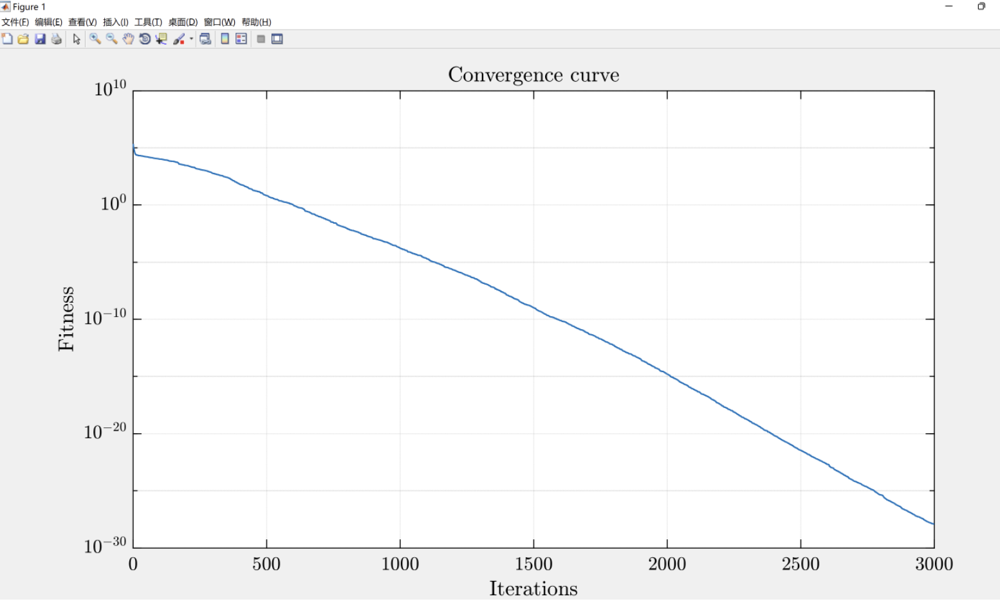

# Optimization Algorithm for Peacocks (Pavo Muticus/Cristatus)

Inspired by the intelligent behaviors of peacock flocks, the design of POA includes effective and efficient exploration and exploitative search operations to provide a proper balance between global exploration and local development. This is achieved to avoid local optima, such as the unique rotational dance behavior of peacocks, their adaptive search behavior during different stages of search, and interactions among different searches. Peacocks;
Five peacocks representing the current optimal solution will also search in the nearby search space through the rotational dance mechanism instead of remaining still. The unique rotational dance mechanism of peacocks contains two different modes of rotation, namely stationary rotation and circling around the food source. It is important to note that the mechanism of initially adopting the current optimal solution will continue to perform neighboring searches, which has never been considered in previous algorithms, which helps to escape local optima;
Peacocks and their chicks tend to adopt adaptive search and proximity mechanisms throughout the entire search process to dynamically adjust their behavior at different stages, thereby achieving a proper balance between local development and global exploration.

## Images

<!-- PAYMENT_BLOCK -->

## Get this dataset

- Payment link (Stripe): [Buy now](https://buy.stripe.com/3cs8yP7sY87d0vu9AB)
- Payment QR code: 

<!-- /PAYMENT_BLOCK -->
